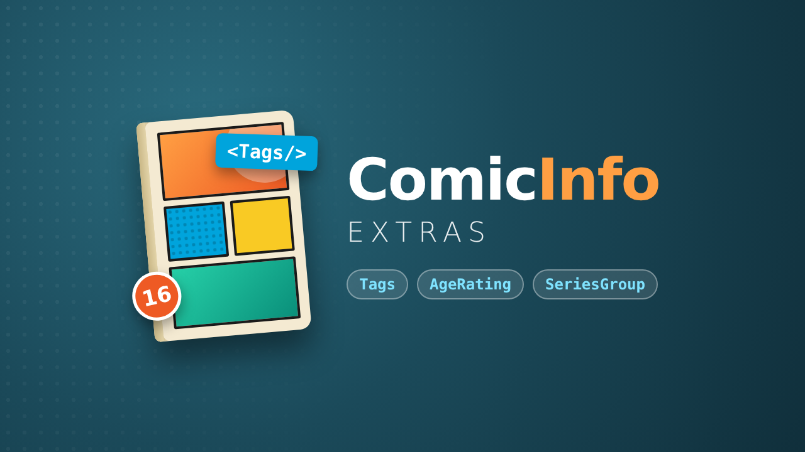

# ComicInfo Extras – Jellyfin Plugin



Jellyfin only reads the title, series, number, summary, date, genre, publisher, language and contributors from `ComicInfo.xml`. This plugin adds five more fields to books:

| ComicInfo | Jellyfin | Behavior |
|---|---|---|
| `Tags` | Tags | comma-separated (`;` also accepted), added to existing tags |
| `AgeRating` | Age rating | mapped to FSK or US levels, takes effect for parental controls |
| `CommunityRating` | Community rating | 0 to 5 in ComicInfo, doubled to Jellyfin's 0 to 10 scale (`4.13` becomes `8.26`) |
| `Series` | Sort title | used as-is, e.g. `The Cummoner 001` |
| `Characters` | Cast | comma-separated, added as actors with the role "Character" |
| `SeriesGroup` | Tag and/or collection | tag with prefix (`SeriesGroup: Batman Family`) or collection of the same name |

Locked fields (tags, age rating, cast) in the metadata editor are respected.

## Installing

Requires Jellyfin **12.2** or newer (the plugin targets ABI `12.2.0.0`, .NET 10).

### From the plugin repository (recommended)

Installing through the repository gives you the catalog entry and automatic update notices.

1. Open the Jellyfin dashboard and go to **Plugins → Repositories** (in some versions: *Catalog → gear icon*), then click **+**.
2. Enter any name (e.g. `ComicInfo Extras`) and this URL, then save:

   ```
   https://raw.githubusercontent.com/MoritzGrossmann/jellyfin-plugin-comicinfo-extras/master/manifest.json
   ```

   Want pre-releases too? Use `manifest-beta.json` instead of `manifest.json`.
3. Open the **Catalog** tab, find **ComicInfo Extras** under *Metadata* and click **Install**.
4. Restart Jellyfin. The plugin must show the status **Active** under *Dashboard → Plugins*.
5. Check the plugin settings (rating system, SeriesGroup mode).
6. For the book library: *Refresh metadata → Replace all metadata*.

**Updating:** new releases appear in the catalog (and under *Dashboard → Plugins*) automatically. Install the update and restart Jellyfin.

**Plugin not listed or "unsupported"?** The server version must be at least the plugin's `targetAbi` (12.2.0.0). Older servers do not show or load it.

### Manual

Download the ZIP from the [latest release](https://github.com/MoritzGrossmann/jellyfin-plugin-comicinfo-extras/releases) and extract it into the server's plugin folder, in a subfolder named `ComicInfo Extras_<version>`:

- Windows (installer/service): `C:\ProgramData\Jellyfin\Server\plugins\ComicInfo Extras_<version>\`
- Linux package: `/var/lib/jellyfin/plugins/ComicInfo Extras_<version>/`
- Docker: `/config/plugins/ComicInfo Extras_<version>/`

Then restart Jellyfin and continue with step 4 above.

The provider does **not** appear in the library settings and does not need to be enabled there: Jellyfin only lists local readers, online sources and storage there, while custom providers always run.

## How it hooks in

The plugin is an `ICustomMetadataProvider<Book>`. It runs **after** Jellyfin's own "Comic Provider" and does not replace it. An additional `ILocalMetadataProvider` would not work, because Jellyfin stops after the first local provider that returns a result.

It looks for the file the same way Jellyfin does:

1. `<filename>.xml` next to the book,
2. otherwise `ComicInfo.xml` in the same folder,
3. otherwise `ComicInfo.xml` inside the `.cbz` archive (the plugin also searches subfolders of the archive, while Jellyfin only checks the root).

## AgeRating mapping

Intermediate levels are rounded up, so parental controls err on the side of being too strict rather than too lax.

| ComicInfo | Minimum age | FSK | US |
|---|---|---|---|
| Early Childhood, Everyone, G | 0 | FSK 0 | G |
| Kids to Adults | 6 | FSK 6 | PG |
| PG, Everyone 10+, E10+ | 10 | FSK 12 | PG |
| Teen | 13 | FSK 16 | PG-13 |
| M, MA15+ | 15 | FSK 16 | R |
| Mature 17+ | 17 | FSK 18 | R |
| R18+, X18+, Adults Only 18+ | 18 | FSK 18 | NC-17 |
| Unknown, Rating Pending | – | leave unset | leave unset |

Unknown values (e.g. `FSK 12`, which is already in the target format) are passed through unchanged. Custom mappings in the plugin settings take precedence, e.g. `Teen=FSK 12`.

## Building

Requirement: Docker. No local .NET installation needed.

Windows (PowerShell, Docker Desktop):

```powershell
.\build.ps1                            # against Jellyfin 12.2.0
.\build.ps1 -JellyfinVersion 12.4.0    # against a different server version
```

Linux/macOS:

```sh
./build.sh                          # against Jellyfin 12.2.0
JELLYFIN_VERSION=12.4.0 ./build.sh  # against a different server version
```

**The build version must match the server or be older.** Jellyfin does not load a plugin whose `targetAbi` is higher than the server's version; it then shows up as unsupported under *Dashboard → Plugins*.

Result: `dist/comicinfo-extras_<version>.zip` containing the DLL and `meta.json`. The version is read from `build.yaml`. The script runs the unit tests first.

With a local .NET 10 SDK you can also run:

```sh
dotnet test
dotnet publish Jellyfin.Plugin.ComicInfoExtras -c Release -o out
```

The NuGet version of `Jellyfin.Controller`/`Jellyfin.Model` must match the server version (`JellyfinVersion` in `Directory.Build.props`), and so must `targetAbi` in `build.yaml`.

## Versioning and releases

The version has four parts, as Jellyfin requires: `MAJOR.MINOR.PATCH.REVISION`.

| Part | Meaning |
|---|---|
| `MAJOR.MINOR.PATCH` | [Semantic Versioning](https://semver.org): breaking change / new feature / bug fix |
| `REVISION` | `0` = stable release, `1` and up = beta toward the next stable version |

`build.yaml` is the single source of truth: the assembly version, `meta.json` and the repository manifest all derive from its `version` and `changelog`.

Channels:

- **Stable** (`manifest.json`): a normal GitHub Release with revision `.0`, e.g. `v1.2.0.0`.
- **Beta** (`manifest-beta.json`): a GitHub *pre-release* with a non-zero revision, e.g. `v1.2.0.1`. The beta manifest also contains all stable releases.

To publish a release:

1. In `build.yaml`, set `version` (e.g. `"1.2.0.0"`) and describe the changes in `changelog`. Commit and push to `master`.
2. On GitHub, create a release with the tag `v<version>` (e.g. `v1.2.0.0`). Tick *Set as a pre-release* for betas.
3. The `build` workflow then tests and packages the plugin, attaches `comicinfo-extras_<version>.zip` to the release and commits the updated manifest(s) to `master`.

The workflow fails early if the tag does not match `build.yaml` or if the revision does not fit the channel (stable must end in `.0`, pre-releases must not). When you raise `JellyfinVersion` for a new server version, update `targetAbi` in `build.yaml`, `JELLYFIN_VERSION` in `scripts/package.sh` and `.github/workflows/build.yaml` as well.

## Limitations

- Removed entries from `<Tags>` stay as Jellyfin tags until "Replace all metadata" is run. SeriesGroup tags (with prefix), on the other hand, are replaced on every update.
- As with Jellyfin itself, only `.cbz` archives are opened. For `.cbr`/`.cb7` only the external XML file works.
- The plugin recognizes its collections by the provider ID `ComicInfoSeriesGroup`. Collections that become empty are kept and can be deleted manually.
